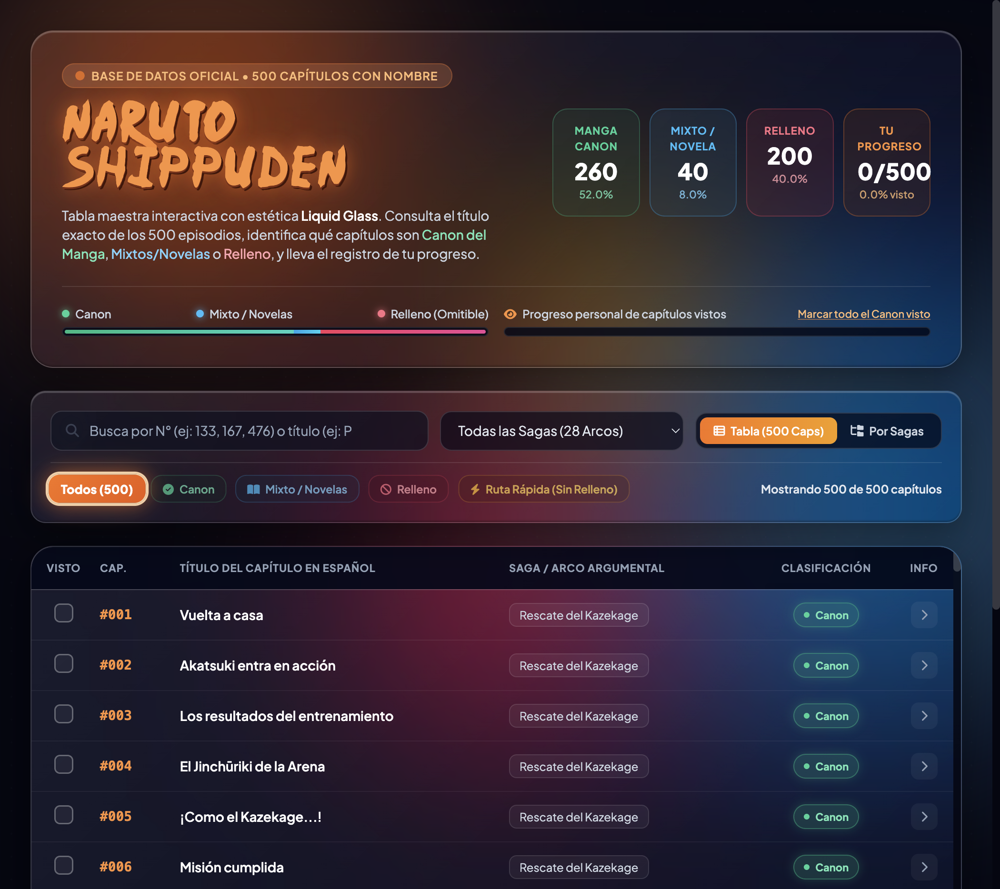

# Guía de episodios de Naruto Shippuden

Guía interactiva de los 500 episodios de *Naruto Shippuden*. Permite consultar sus títulos, ver la saga a la que pertenecen y distinguir entre episodios canon, mixtos/novelas y de relleno.

## Funciones

- Busca episodios por número, título o saga.
- Filtra la lista por saga y por clasificación: canon, mixto/novela o relleno.
- Usa **Ruta Rápida (Sin Relleno)** para ocultar los episodios clasificados como relleno.
- Cambia entre la tabla de episodios y la vista agrupada por sagas.
- Marca episodios como vistos con las casillas de la tabla y consulta tu avance en el panel superior.
- Abre la información de un episodio seleccionando su fila para ver detalles de la saga y desplazarte entre episodios.

El progreso se guarda en el almacenamiento local del navegador y se conserva al volver a abrir la página en ese mismo navegador. No se sincroniza entre dispositivos ni navegadores.
